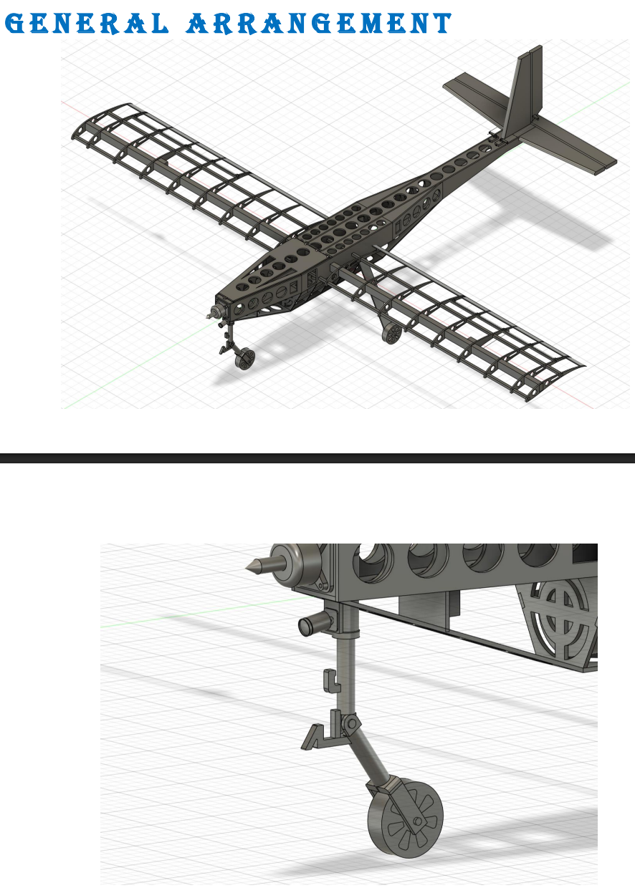
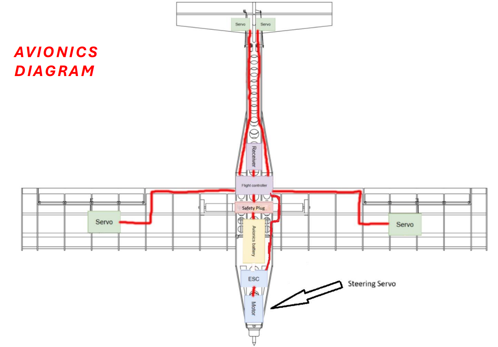
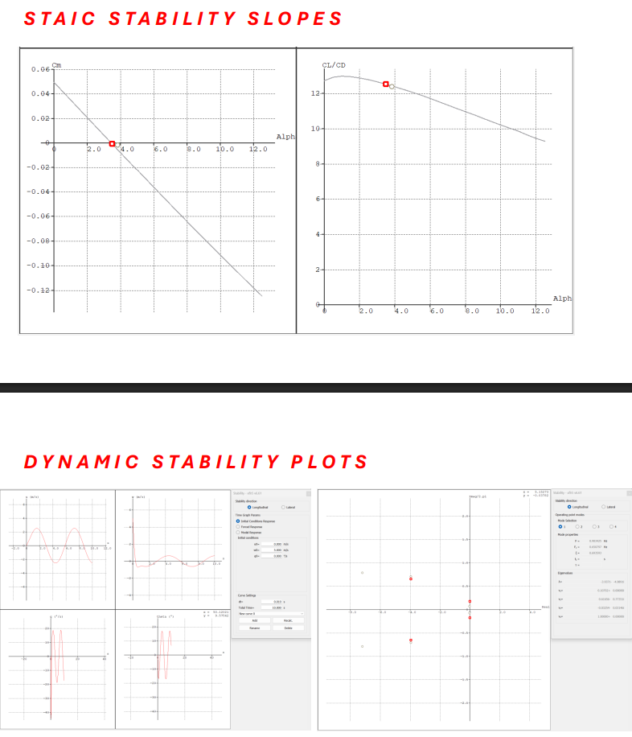
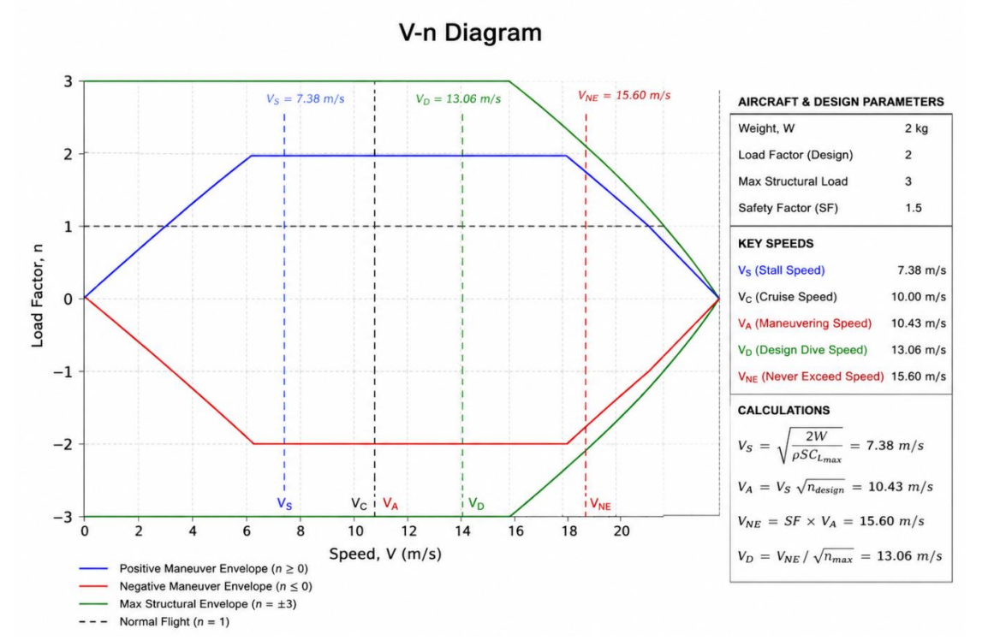

# RC3 Payload Delivery Plane

A fixed-wing RC aircraft designed to carry an 8 oz (237 mL) water bottle and land it as close as possible to the center of a target zone. Built by **Team Blizzard** for TMAD RC3 2026 at Toronto Metropolitan University.

**Design report (PDF):** [Plane_Design_Report.pdf](docs/Preliminary_Design_Report.pdf)

## Mission Requirements

- Transport and land a standard 8 oz water bottle in a landing zone with maximum precision
- Fixed-wing only (no multicopters or lighter-than-air craft)
- Total gross weight under 5 kg
- Take off from a 15 m tarp runway (high rolling resistance)
- Pitch and roll control required, yaw optional
- Score is based on how close the landing is to the center of the zone

## Design Summary

| Parameter | Value |
|---|---|
| Configuration | High wing, conventional tail, tricycle landing gear with steerable nose gear |
| Control surfaces | 2 ailerons, elevator, rudder |
| Wingspan | 1.5 m |
| Chord | 200 mm |
| Wing area | 0.3 m² |
| Wing loading | 6.67 kg/m² |
| Length / height | 1050 mm / 430 mm |
| Airfoil | Selig S1223 (switched from Clark Y for higher lift) |
| Target gross weight | about 2 kg |
| Cruise speed | 10 m/s |
| Stall speed | 7.38 m/s |

## Design Philosophy

- **Stiff airframe:** 1/8" plywood construction keeps the plane rigid and reduces vibration
- **Easy handling:** a long tail and large wing area make it naturally stable
- **Heavy lifter:** the design favors carrying the payload over high speed or steep climbs
- **Belly payload bay:** a 200 mm x 60 mm bay sits directly under the center of gravity, so the plane's balance doesn't change when the payload is dropped

## Airfoil Selection

| | Clark Y (previous) | Selig S1223 (current) |
|---|---|---|
| Cl | 0.4 | 1.2 |
| Pros | Medium to high lift, easy to build | Ultra-high lift |
| Cons | Nose-up pitching moment | Harder to build, high drag at higher speeds |

At 3.5° angle of attack and 10 m/s, the wing produces CL = 1.226. Maximum CL is 1.96 at 12.5°.

## Avionics

An FPV camera on the nose feeds video to the flight controller. The Matek F405 runs **ArduPilot** and adjusts the throttle and control surfaces for automatic navigation and landing.

| Component | Part |
|---|---|
| Flight controller | Matek F405 |
| Receiver | HappyModel EP2 (ELRS) |
| Transmitter | TX165 Mk.11 (ELRS) |
| Motor | 2814 1100 KV brushless, 12" x 4.5" propeller |
| ESC | 40 A |
| Battery | 11.1 V 2200 mAh LiPo |
| Servos | 4x FT9G 9-gram |
| Camera | FPV camera |
| Safety | Safety plug in the power circuit |

### Endurance Estimates

| Phase | Calculation | Result |
|---|---|---|
| Full throttle | 2.2 Ah / 35 A | about 3.75 min |
| Cruise | 33.5 W / 11.1 V = 3.0 A, so 2.2 Ah / 3.0 A | about 44 min |

Cruise assumes L/D = 8.5 and motor efficiency of 4.8 g/W.

## Weight and Balance

| Component | Weight (g) |
|---|---|
| Fuselage | 450 |
| Wings | 600 |
| Battery | 200 |
| Tail | 150 |
| Main landing gear | 120 |
| Motor | 100 |
| Avionics | 90 |
| Nose gear | 40 |
| **Total (without payload)** | **1750** |

The estimated CG is 325 mm from the reference point. The 250 g payload brings the aircraft to about 2000 g.

## Stability

- Neutral point (aft CG limit): 108 mm from the leading edge
- Static margin: (108 - 75) / 200 = **0.165** (positive, so stable)
- CG envelope: forward limit at 21% of chord, aft limit at the neutral point (54% of chord)
- Static and dynamic stability plots and trim analysis (within 5°) were done in xflr5

## Structures

- Designed for 2g maneuvers with a safety factor of 1.5 (a 6 kg equivalent load)
- Planned static test: a 6 kg weight placed on the main spar must not cause cracks or breakage

| Speed | Value |
|---|---|
| Stall | 7.38 m/s |
| Cruise | 10 m/s |
| Maneuvering | 10.43 m/s |
| Never exceed | 15.6 m/s |

## Materials

- 1/8" plywood (fuselage, spars, ribs, landing gear), 1/4" balsa spars, balsa sheet and wedges
- Foam board and covering film for the skin
- 3D-printed hinges and custom parts
- Epoxy and hot glue

## Expected Score

score = 10(1 - x^3)·kMODE,1 + 10(1 - x^3)·kMODE,2, with x targeted between 0.2 and 0.4, for an anticipated score of about 19.28 / 20.

## Timeline

| Dates | Phase |
|---|---|
| May 18-31 | Finalize CAD, run final xflr5 checks, detailed manufacturing plan |
| Jun 1-15 | Manufacture fuselage, wings, and full airframe |
| Jun 16-30 | Install avionics, servos, and linkages; verify CG |
| Jul 1-15 | Calibration, range testing, load testing, taxi tests |
| Jul 16-31 | First flight, failure analysis |

## My Role

**Avionics:** selected and integrated the flight controller, ELRS radio link, ESC, motor, and servos; drew the avionics schematic and safety plug circuit; and estimated endurance.

## Team

Adam Salih (avionics), Yasmeen Khan (CAD), Mahmoud Painda and Muhammad Hamza Ali (landing gear), Alex Ngo, Zuhayr Islam, Amani Abas, Ishpreet Panesar, and Syed Nasif Ahmed (manufacturing), Lutfullah Stanakzai (analysis and CAD).

## Status

Design review complete. Build, testing, and first flight are in progress.

## Tools

- ArduPilot, xflr5
- CAD (add the software you used)
- Matek F405, ExpressLRS
